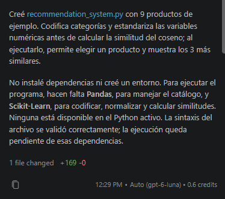
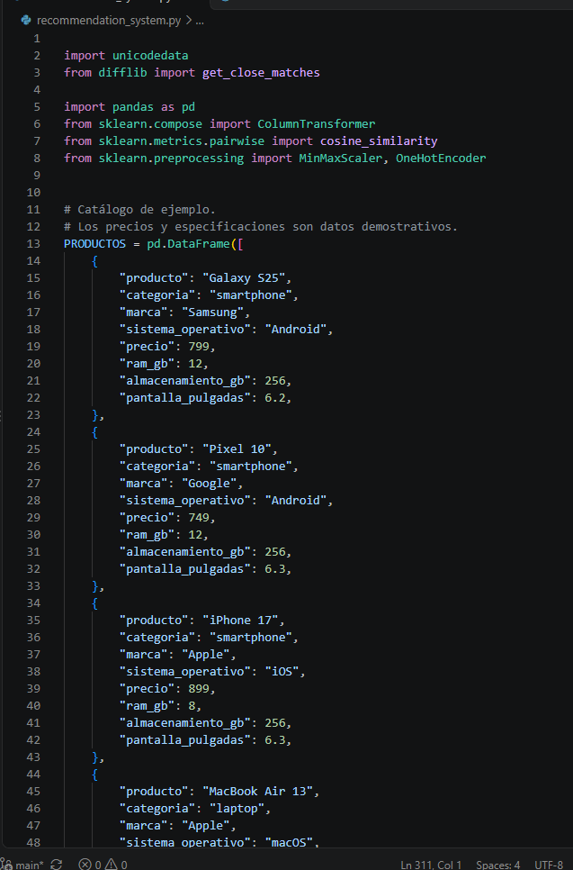
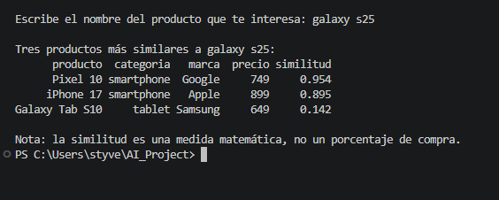

# Sistema de recomendación de productos tecnológicos

## Evaluación formativa de Inteligencia Artificial Aplicada

Este proyecto fue desarrollado para la asignatura de Inteligencia Artificial Aplicada de INACAP. Consiste en un programa sencillo que recomienda productos tecnológicos a partir de las características del producto seleccionado.

## Objetivo

Aplicar conceptos básicos de inteligencia artificial y análisis de datos mediante un sistema de recomendación basado en contenido. La actividad permite observar cómo se preparan datos de distintas características y cómo se comparan productos usando similitud del coseno.

## Herramientas utilizadas

- **GitHub:** almacenamiento y control de versiones del proyecto.
- **GitHub Copilot:** apoyo durante el desarrollo y la revisión de la solución.
- **Visual Studio Code:** edición y ejecución del programa.
- **Python:** lenguaje utilizado para implementar el sistema.
- **Pandas:** organización del catálogo de productos en una tabla.
- **Scikit-Learn:** codificación de categorías, normalización y cálculo de similitud.

## ¿Cómo funciona?

El sistema utiliza un enfoque de **recomendación basado en contenido**. En vez de basarse en las compras de otras personas, compara los atributos de los productos disponibles con los del producto que el usuario selecciona.

El catálogo de ejemplo contiene smartphones, laptops y tablets. Para comparar sus características, el programa:

1. Convierte las categorías de producto, marca y sistema operativo en variables numéricas con `OneHotEncoder`.
2. Normaliza precio, memoria RAM, almacenamiento y tamaño de pantalla con `MinMaxScaler`, que transforma esos valores a una escala entre 0 y 1.
3. Da mayor peso a la categoría que al resto de las características para favorecer recomendaciones del mismo tipo.
4. Calcula la similitud del coseno entre los productos, excluye el producto seleccionado y muestra hasta tres recomendaciones ordenadas por similitud.

La puntuación de similitud es una medida matemática de cercanía entre las características. **No es una probabilidad de compra ni indica la posibilidad de que una persona compre el producto.** Además, el catálogo y sus precios y especificaciones son datos demostrativos, no información de un catálogo comercial actualizado.

## Instalación

Se necesita Python instalado. Desde una terminal abierta en la carpeta del proyecto, se puede crear y activar un entorno virtual e instalar las dependencias incluidas en `requirements.txt`:

```powershell
py -m venv .venv
.\.venv\Scripts\Activate.ps1
python -m pip install -r requirements.txt
```

Si se utiliza el Símbolo del sistema de Windows en vez de PowerShell, la activación del entorno se realiza con:

```bat
.venv\Scripts\activate.bat
```

## Ejecución

Con el entorno virtual activado, ejecutar:

```powershell
python recommendation_system.py
```

El programa muestra los productos disponibles. Escribe el nombre del producto que quieres usar como referencia; la búsqueda acepta minúsculas. Luego se muestran tres recomendaciones, siempre que haya suficientes productos distintos en el catálogo.

## Pruebas realizadas

- **Galaxy S25:** se comprobó que la búsqueda genera tres recomendaciones.
- **Dell XPS 13:** se comprobó que la búsqueda genera tres recomendaciones.
- **Búsqueda en minúsculas:** se comprobó que los nombres se reconocen aunque se escriban en minúsculas.
- **PlayStation 5:** no forma parte del catálogo actual. Al buscarlo, el programa informa que no encontró el producto y finaliza esa búsqueda sin producir un error no controlado.

Las pruebas confirman el comportamiento descrito, pero no se incluyen nombres ni puntuaciones concretas de las recomendaciones porque no son necesarios para documentar estos casos.

## Limitaciones

- El catálogo es pequeño y está compuesto por datos de demostración.
- Las recomendaciones dependen de las características y los pesos definidos en el programa.
- El sistema no utiliza historial de compras, preferencias de usuarios ni datos de ventas.
- Un producto que no esté en el catálogo, como PlayStation 5, no puede recibir recomendaciones.
- Las puntuaciones de similitud no representan probabilidades de compra.


## Proceso de desarrollo

1. Se creó el repositorio público AI_Project en GitHub.
2. Se clonó el repositorio en Visual Studio Code.
3. Se configuró GitHub Copilot Free para apoyar la generación del código.
4. Se creó recommendation_system.py con un catálogo de nueve productos tecnológicos.
5. Se configuró un entorno virtual con Python 3.14 y se instalaron Pandas y Scikit-Learn.
6. Se realizaron pruebas con Galaxy S25, Dell XPS 13 y un producto inexistente.
7. Se mejoró el programa para reconocer búsquedas en minúsculas y priorizar productos similares.
8. Se documentaron los resultados, se incorporaron capturas y se publicó el proyecto mediante Git.

## Evidencias del desarrollo

### 1. Desarrollo con GitHub Copilot

Se utilizó GitHub Copilot como apoyo para generar el código inicial del sistema de recomendación y revisar su funcionamiento.



### 2. Implementación en Python

El programa fue desarrollado utilizando Python, Pandas y Scikit-Learn. Se definió un catálogo de nueve productos tecnológicos con diferentes características.



### 3. Prueba de funcionamiento

Se realizó una búsqueda utilizando el producto Galaxy S25, obteniendo tres recomendaciones ordenadas según su similitud. También se comprobó que el sistema reconoce búsquedas escritas en minúsculas.


  

## Conclusión personal

Esta actividad me permitió practicar la preparación de datos y el uso de similitud del coseno en un caso concreto. También comprendí que el resultado depende tanto de los datos disponibles como de la forma en que se ponderan las características. Como siguiente mejora, ampliaría el catálogo con información real y más productos para obtener recomendaciones más representativas.
